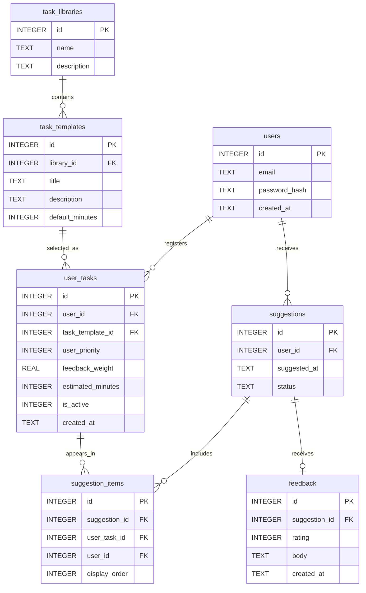

# PBL DB ER図（v0.1）
## 設計の前提
- 利用可能時間 `available_minutes` は提案APIへの入力値であり、DBには保存しない。
- 共通タスクは `task_templates`、各人の登録したタスクは `user_tasks`。
- 「表の係数」`user_priority` と「裏の係数」`feedback_weight` はユーザー別に保持。
- 提案は `suggestions` でひとまとまりを表現し、その構成タスクのIDを `suggestion_items` に保存。
- フィードバックは提案全体に紐付く。最大1件の暫定設計。
- 提案時の名前・係数のスナップショットは保存しないため、後から更新した値が過去履歴の表示に反映される。削除は履歴を壊さないようアーカイブ推奨。
- 同じユーザーが同じテンプレートを重複登録することはできない。
- LLMによる係数更新方式は今後決定（DBは更新手段に依存しない）。

## Mermaid ER図

## APIの動作例
入力：`{ "available_minutes": 20 }`

1. 認証したユーザーの `user_tasks` から有効なものだけを取得。
2. `COALESCE(user_tasks.estimated_minutes, task_templates.default_minutes) <= 20` で候補を絞る。
3. 今後確定する提案計算式に従い候補から選ぶ。
4. `suggestions` に1行、`suggestion_items` に選ばれたタスク数だけの行を作成（同一トランザクション）。
5. ユーザーから評価が来たら `feedback` に提案IDで記録する。

SQLiteでは接続ごとに `PRAGMA foreign_keys = ON;` が必要です。
